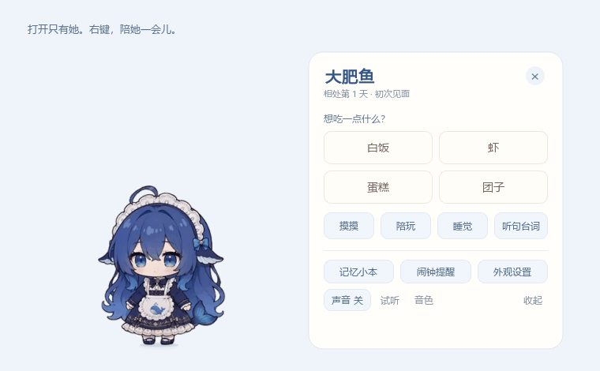

# 大肥鱼 · 离线养成桌宠

把一只大肥鱼放在桌面上，喂饭、摸摸、陪她玩，也慢慢留下属于你们的相处记录。

独立 Windows 桌宠。运行时不需要账号、API、模型，也不用绑定 QQ、DSH、Codex 或其他软件。启动只出现透明桌宠，记忆本和设置按需打开。



**[下载 Windows 版 → Releases](https://github.com/haha997123/dafeiyu-offline-pet/releases/latest)**

## 下载后怎么玩

从 Releases 下载运行包，**完整解压**后双击 `大肥鱼.exe`。请保留旁边的 `_internal` 文件夹，不要把 EXE 单独拿出来。

| 操作 | 效果 |
| --- | --- |
| 拖起来，松开鼠标 | 默认停在松手的位置做小动作；已选“跟随”时继续跟随 |
| 点击、长按头部 | 摸摸与回应，记入相处记录 |
| 点击身体或尾巴 | 对应部位的小动作 |
| 双击角色 | 打开投喂选择 |
| 右键角色 | 打开小互动卡：投喂、摸摸、陪玩、睡觉、声音与设置 |
| 托盘图标右键 | 找回桌宠、恢复鼠标互动、打开记忆小本、退出并保存 |

在“外观设置”可以切换散步、原地和跟随。悬停模式支持上下左右跟随鼠标，也可以选择重力落地、窗口落脚。**按住外观面板顶部标题栏可以移动它**；不清楚的选项，停留鼠标稍等便会显示说明。

## 可以慢慢养，也能关掉再回来

- **长期记忆**：主人称呼、生日、喜好和手写记忆保存在本机；投喂的食物、摸头、陪玩等都有时间记录，可以查看、搜索和回忆。
- **日常成长**：等级同时需要经验和相处天数，每日经验最多 60 点。达到上限后仍会保存互动，不用反复刷点击。熟悉后解锁心声、一起整理和晚安小仪式。
- **安静陪伴**：可以关声音、减少动态、隐藏桌宠，或一起开一段专注计时。设置面板和记忆本都能随时关闭。
- **自己的声音**：内置社区角色预录原声，默认关闭。可导入 ZIP 或音频文件夹，选择音色、音量、输出设备，再自行试听。
- **闹钟提醒**：一次、每天或工作日重复，到期弹窗可选择 5 分钟后再提醒。提供总开关和独立提示音开关。

这里的记忆与回应来自本地记录、规则和固定台词。它不理解任意自由聊天，也不会把日记、主人名字自动合成为语音。本地感知是可选功能，只使用已开启的本机元数据，不读取聊天正文。

## 听台词和闹钟

右键互动卡的“听句台词”会播放一条预录台词，字幕与录音对应；它不录音，也没有语音识别。试听和各个互动场景会轮换台词，一轮听完再重复。音色页保留温柔日常 22 句，并可选择完整 49 句版；完整版含亲昵称呼和小剧场台词。开启“平时也说话”后，空闲时约每 1.5～3 分钟尝试说一句；睡眠、专注、安静时段和面板打开时暂停。

右键互动卡或托盘进入“闹钟提醒”，选择文字、日期时分和重复方式。“工作日”指周一至周五，不判断节假日调休。可编辑、删除或停止单个闹钟，**取消“启用闹钟提醒”后不会弹窗或响铃**。关闭期间仍可保存和编辑，重新开启后每个过期闹钟最多补提醒一次。提示音可单独关闭，夜间安静时段保持静音。

程序关闭或电脑睡眠时无法准点提醒；重新打开或唤醒后会补一次，随后继续下一次重复。闹钟存档保存在本机，更新会自动迁移旧记录。新版备份含重复规则和开关，旧版备份也可导入。

功能设计参考了 [VPet](https://github.com/LorisYounger/VPet) 的日常养成与扩展思路，以及 [DSH 桌宠](https://github.com/PC2005-cloud/dsh-pet) 和 [桌面移植版](https://github.com/MerZlin/dsh-pet-indesktop) 的互动、提醒与免打扰体验。

## 导入语音包

在小互动卡点击“音色”，进入“她的音色”下方的导入入口。支持 **WAV、MP3、OGG**，不需要语音 API 或模型权重。

没有清单时，可以直接放入 `喂饭.wav`、`摸头.wav`、`睡觉.wav` 等文件，程序根据文件名识别互动类型。文件名不视为已核实的字幕，播放时会显示“播放导入的语音片段”。

需要精确分类和字幕时，在音频文件旁放一个 `manifest.json`：

```json
{
  "name": "我的语音包",
  "clips": [
    {
      "id": "feed1",
      "category": "feed",
      "text": "吃饭啦！",
      "file": "喂饭.wav"
    }
  ]
}
```

导入会复制音频，保留原文件；**不会自动开启声音或播放**。请使用有权使用的录音。之前试验的两套通用合成候选已移除。

## 存档与备份

发布版存档位于：

```text
%LOCALAPPDATA%\DaFeiYuCompanionDiary
```

换电脑前，可以在记忆本中导出备份。JSON 备份包含档案、记忆、成长和互动记录，**不包含导入的音频**；语音包请另行保留，或一并复制存档目录中的 `voicepacks` 文件夹。

更新前从托盘退出旧程序。替换程序文件夹不会清除上述存档。详细使用说明见 [README_DIARY.md](README_DIARY.md)。

## 从源码运行

需要 **Windows、Python 3.10**。以下命令在仓库根目录的 PowerShell 中执行：

```powershell
python -m venv .venv
.\.venv\Scripts\python.exe -m pip install -r requirements-build.txt
.\.venv\Scripts\python.exe main.py
```

`requirements-build.txt` 锁定了 PySide6、Pillow、psutil 和 PyInstaller，同时安装了打包工具，依赖体积比普通运行环境大。首次安装依赖需要网络；应用运行与语音播放均在本机完成。

源码运行默认将开发存档写在仓库根目录。也可在运行前指定独立目录：

```powershell
$env:DAFEIYU_DATA_DIR = Join-Path $PWD '.local-data'
.\.venv\Scripts\python.exe main.py
```

### 测试

```powershell
.\.venv\Scripts\python.exe -m pip install -r requirements-dev.txt
$env:QT_QPA_PLATFORM = 'offscreen'
$env:DAFEIYU_SILENT = '1'
.\.venv\Scripts\python.exe -m pytest -q
```

测试使用临时存档，不需要填写密钥、修改真实存档或播放声音。Windows / Python 3.10 的自动测试模板见 `docs/ci/windows-tests.yml`。

### 重新打包

```powershell
.\.venv\Scripts\python.exe tools\package_companion.py --outputs .\release-work
```

生成独立程序目录、运行包 ZIP 和源码 ZIP。输出已存在时会停止，请换一个输出目录。不要将自己的存档或导入语音混入公开源码、素材目录或发布包。

## 来源与许可

本项目是 [QCYTSN/ds-local-pet](https://github.com/QCYTSN/ds-local-pet) 的独立离线养成改版，并保留其上游 [1190fasheqi/dafeiyu-pet](https://github.com/1190fasheqi/dafeiyu-pet) 的来源。项目使用了社区“大肥鱼”形象，**非 DeepSeek 官方项目**，与 DeepSeek 不存在隶属或认可关系。

| 内容 | 来源与许可 |
| --- | --- |
| Python 应用代码、交互与养成扩展 | MIT，保留各上游版权；见 [LICENSE](LICENSE)、[CREDITS.md](CREDITS.md) |
| 角色形象、连续动画及其格式转换素材 | [PC2005-cloud/dsh-pet](https://github.com/PC2005-cloud/dsh-pet)，CC BY-NC-SA 4.0 与上游非商业条款；角色原型与设计署名见 [动画来源说明](assets/community/NOTICE.md) |
| 社区角色预录音频 | [bauerelizabeth07139/dsh-pet-dafeiyu](https://github.com/bauerelizabeth07139/dsh-pet-dafeiyu)，保留上游 MIT 与生成来源说明；见 [语音来源说明](companion_voicepack_notice.md) |
| Python、Qt、PySide6 等依赖 | 各自许可；见 [第三方声明](THIRD_PARTY_NOTICES_DIARY.md) 与 `licenses/` |

**代码 MIT 不代表角色媒体也适用 MIT。** 带角色素材的整包按非商业条件公开；二次分发、改版请保留来源署名并遵守素材相同方式共享等条款。详细边界见 [ASSET_LICENSE.md](ASSET_LICENSE.md)。

如果报告问题，请附上版本、Windows 版本、显示器缩放和复现步骤。请勿提交自己的存档、私密窗口标题、录音或凭据。
